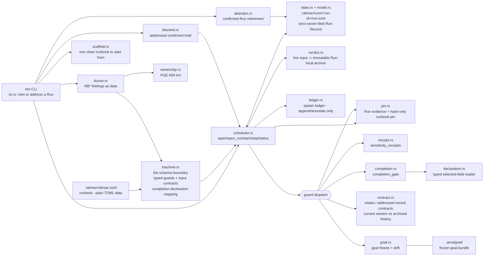

# ratmac

ratmac (`rtm`) is a Rust engine that runs agent work as an explicit state
machine. Its shared runtime root is the primary checkout's `.ratmac/`; the Machine Class
(`.ratmac/ratmac.toml`, plain TOML) is read from the invoking checkout and declares States,
prompts, guards, and transitions; the Engine instantiates it into a Run and is the only writer
of run state. Progress is proven by machine-checked guards over artifacts on disk - never by an
agent's claim. Deterministic and offline: no network, no installs, no hidden global state.

Consult this file first, every time: the map below orients you; the routes
table locates every file; then read the file itself. The map is orientation
only, **never evidence** - a residual may not cite it.

**Where are we?** `rtm status --run <id>` answers it. The **Plan-Build
Runbook** (`.ratmac/ratmac.toml`) is this project's Machine Class, so the
sprint's stage *is* the addressed Run's State: `intake`, `gap-check`,
`cut-tickets`, `ticket-turns`, `close`, `rest`. A sprint has one entry and one
end, so one Run answers for it from start to rest. With no argument, `rtm
status` prints the roster.

**No-live-Run fallback.** Only while the roster is empty - the window between
sprints - derive the stage from the tree, in order: open tickets in
`.arca/ticket/` -> P4/P5 (building); `missing|partial` residuals without
tickets -> P3; goal frozen but residuals stale -> P2; a `pending` issue bundle
directly under `.arca/issue/` -> P1; none of the above -> Idle. Bundles in
`.arca/issue/deferred/` are live waiting work but do not force P1. Selecting
one visibly moves that same complete bundle to the intake work area and
changes its status to `pending`. This derivation is the no-live-Run fallback
and never competes with a live Run: while one exists, its Run Record is the
only answer.

## Map - how ratmac hangs together

Stamped cache - describes the tree through the WRS, WEB, WCP, and WRA
tickets (`t-114` through `t-136`), surveyed 2026-10-16.
The full doctor executable fingerprint first
landed in the full-doctor-fingerprint ticket (`t-070`, `3e6ee6c`). The accepted
carrier remains `.arca/issue/archive/i-023-doctor-full-fingerprint/`; `DFP-001`
widens only the argument-free human doctor's rendered Engine SHA-256 from a
16-character prefix to the complete 64-character lowercase digest. That
landing's public proof is in `test/qa/tests/t045_bootstrap_doctor.rs`, and
`test-hidden/t-058/` through `test-hidden/t-070/` held its hidden lanes. The
lane-recovery cycle and expiry-aware turn-close ticket added no `src/`
changes. `t-112` then landed generic typed completion-field selection, and
`t-113` repaired review snapshots and reopened-work classification. Every
Architecture, Binary, Modules, and Tests row below describes this landed tree.
The tracked Plan-Build Runbook now selects its three completion fields
explicitly; stable `edition-007` drove `run-030` to `rest` before this
activation. Future Runs use the recorded stable edition's Engine. Refresh at
each cycle close (gap check green).

The state-vocabulary cutover (`SVC-001`-`SVC-010`, goal `ADR-0012`) has landed:
every row below reads State for the machine position, `states` for the runbook
table, and `run.toml` for the Run Record.

### Architecture

### Binary

`rtm` - hand-rolled CLI (`src/cli.rs`, no clap): `init`, `start`, `status`,
`step`, `hold`, `intent`, `resume`, `recover`, `abandon`, `spawn`, `respawn`,
`doctor`, `scaffold`, `skill`, `endpoint`, `profile`. `start`
takes no Run id and mints the next roster member; `status` and `step` require a
canonical exact `--run <id>`, `hold` binds through the same `open_run`
preflight, and retiring a live Run requires its roster id. `spawn` creates a
declared child from a parent's spawning State as ordinary checked motion;
`respawn` and live-run `abandon` demand `--confirm` phrases naming the run id
(FDC-007). Only leftover-lock retirement may be unaddressed; missing or unknown
addresses report the resolved Engine root's `.ratmac/runs/` roster. `doctor` is
read-only and deep: its argument-free human report identifies the exact running
Engine with the complete 64-character lowercase SHA-256, its build channel and
source commit, the local stable-edition resolution or refusal, off-pin live
Runs, and the resolved Engine root before the parse, graph, guard-lint, and
ownership findings over `MachineClass`. `--json` emits an object containing
`engine_root` and the `findings` array, with exit `0`/`1`/`2` for clean,
warnings, and errors. `rtm doctor <path>` diagnoses any runbook file - an
unreadable path is finding `RB101`, not a usage error. `rtm scaffold <path>`
writes the one runbook that starts clean. `rtm skill <path>` atomically writes
the identity-stamped operator-skill folder at a new path and never overwrites.

### Modules (src/)

| Module | Role |
| :--- | :--- |
| `cli.rs` | Hand-rolled parsing of sixteen verbs and exit codes; the `COMMANDS` route table is the one source of the usage's `Commands:` line (WEB-004). It dispatches the addressed lifecycle commands plus `init`, `doctor`, `scaffold`, `skill`, `endpoint`, and `profile`; argument-free human `doctor` renders the executable's full SHA-256, channel/source provenance, stable-edition resolution, and resolved Engine root, while JSON carries `engine_root` and `findings`. It contains no graph or guard policy. |
| `teach.rs` | AOP-002: the Engine's own next-act table. Every status and step rendering ends in exactly one `next:` line naming a command the Engine dispatches and accepts in that state, or omits it for a terminal Run; `status_next`, `step_refusal_next`, `addressing_next`, and `error_next` derive the line from the Run's recorded status, the first refusal failure's kind, the roster, or the halting error, never from hand-kept prose. A step refusal teaches `rtm step` again (R-020), except the terminal refusal, which teaches `rtm status`; an unreadable Run Record (R-027) or a retired Run teaches `rtm start`, and any other halting error `rtm doctor`. |
| `diag.rs` | The Engine's one owner of standard error (t-128). `diagnostic` writes the mandatory diagnostics - entry-point errors and `warning:` lines - byte-identical whether tracing is on or off; `event` writes one `rtm-trace:` line per traced decision only while tracing is on, and a failed write changes no decision. The binary calls `latch_from_environment` once, before dispatch: `RATMAC_TRACE=1` enables tracing, unset, empty, or `0` disables it, and any other value refuses before any work; library entries never read it, and a disabled `event` never calls its closure or allocates. `nested_child_stdio` gives nested-invocation children detached input and captured output (WEB-006). |
| `observe.rs` | WEBV-014: the operation observer. In a `test-fault-injection` build, `operation` appends the operation kind (`roster`, `record`, `ledger`, `runbook`, `blocker`, `target`, or `lock`) as one line to the file `RATMAC_TEST_OPERATION_LOG` names; unset, empty, or built without the feature, it reads and writes nothing extra. `quiet_records` opens a scope whose `record` operations are not logged, and the residue inspection never passes through here. |
| `graph.rs` | `State`, `Transition`, `MachineGraph` - graph position without lifecycle. `transition_for_input` selects the unique ordinary edge whose optional `input` exactly matches; `None` selects an unlabelled straight edge. `has_ordinary_outgoing` is the structural terminal predicate the Scheduler and endpoint use (blocked routes excluded). Declaration order and guards never select, and blocked routes remain hold-only. |
| `machine.rs` | `MachineClass::from_toml` - the whole runbook schema boundary, hand-rolled over `toml::Value`; only the Scheduler's pre-cutover residue scan (`RB111`) parses the runbook outside it. It retains the top-level named `roots`, the top-level `program` identity (WEB-006), top-level and per-class `review` policies, typed `GuardKind`, each completion guard's optional `CompletionDeclaration`, closed State `inputs`, Transition `input`, inline `classes`, per-State `spawns`, and the `join` and `nested_run` guards; malformed declarations are rejected by their stable `RB*` codes. |
| `declaration.rs` | `DeclarationFormat`, `CompletionDeclaration`, and the one strict selected-string-list reader. For `front-matter-string-lists`, it reads only the three mapped column-one fields, preserves opaque values and order, and refuses malformed or truncated lists, missing peers, empty entries, or duplicates; it has no project field names or prose fallback. |
| `roots.rs` | Parses and validates the Machine Class's optional `[roots]` role-to-repository-relative-path declarations, rejecting malformed, missing, escaping, or Engine-overlapping roots before lifecycle use. |
| `scheduler.rs` | Project/Run binding and ordinary execution. `open` has no Run; `open_run` binds one canonical live roster member. `open`/`open_run` and `start` refuse flat residue, while pinned reads reject runbook drift. `start` mints a never-reused id through `mint.rs`, with no active-Run cap (FDC-006/ENS-004), and writes `passed` when the initial State is terminal; `step` refuses a passed Run by name, evaluates guards before verdict routing/consumption (a governed Run with an amendment chain first authorizes its verdict-routed motion, WRS-004), and writes `passed` beside a terminal successor in one replacement; `status` reloads and reports read-only. `resolve_state_scope` reads a child Run through its own class's view for step and status alike (FDC-011/FDC-012); `spawn` mints a declared child as an ordinary flat Run and appends its ledger entry, refusing any parent that is itself a recorded child (FDC-012); `respawn` supersedes by confirmed phrase; the `join` guard reads the ledger's live children's terminal facts. |
| `mint.rs` | Durable Run-identifier minting. Under the root lock its caller must already hold, `next` reserves one past the larger of the `<engine-root>/mint.toml` high-water ordinal and the highest `run-NNN` ordinal in the roster, persists it, and only then returns the canonical id, so removing a directory never makes an id available again. A record already at `i64::MAX` refuses as `mint namespace exhausted` and mints nothing. |
| `lock.rs` | Engine lock domains: the short root lock (`RootLock`, `locks/root.lock`) protects minting and shared roster, ledger, or ticket mutation, and a Run lock (`RunLock`, `locks/runs/<id>.lock`) protects motion of one addressed Run; `acquire_root_then_run` takes both, root first, under one deadline. Each guard keeps a kernel advisory claim for its whole life - one byte at offset 1,073,741,824 on Windows, `flock` on Unix - beside a diagnostic token that is not an ownership decision; every wait is bounded by `WAIT_TIMEOUT` (five seconds) and reads a Windows holder's delete-pending release as ordinary contention. `PolicyLock` serializes the tracking-policy step (WEB-002) directly in the Engine root, and `refuse_legacy` refuses the legacy `schd.lock` residue. |
| `ledger.rs` | The Scheduler-owned per-run spawn ledger (FDC-011): append at spawn, successor entries at respawn, abandoned-mark flips at retirement - never rewritten; strict read refuses malformed entries by name. |
| `roster.rs` | WRS-005: the descriptive Run roster. Every refusal that prints the roster summary (`runs: run-001, run-002`) follows its first line with `rows`, one line per entry: the address, its top-level or child role, parent, class, bindings, and supersession as spawn ledger records, then State and status when its Run Record reads; retired, missing, and unreadable records, damaged ledgers, and stray directories are labeled, never omitted or guessed. `Records` reads only Engine-owned records - each Run Record, each roster member's spawn ledger, and the transition log, each once - reads no runbook, runs no guard, and writes nothing. |
| `nested.rs` | WEB-006 (t-134): the nested-invocation machinery the parent's `nested_run` guard and the child endpoint share, with no policy of its own: the strict 12-field `ratmac-receipt-v1` `ReceiptEnvelope` codec; the parent-owned `nested-ledger` (append/annotate only, mechanically identical to the spawn ledger), whose `consume` flip a graceful rollback can restore exactly; and the dedicated `ReceiptPipe`, whose write end alone reaches the endpoint, which makes it non-inheritable before launching anything. |
| `lineage.rs` | WEB-006 (t-134): the one codec of the `ratmac-lineage-v1` invocation-lineage record - the ordered (declared program identity, canonical Engine root) `Entry` pairs of one nested call chain, newest last. `encode` and `parse` frame the bytes; `to_carrier` and `parse_carrier` carry them as lowercase hexadecimal, because argv and the environment cannot carry a NUL byte; `repeated_identity` and `repeated_root` find the first repeat in a chain; `DEFAULT_MAX_DEPTH` (16) is the depth a declaration may tighten but never loosen. |
| `endpoint.rs` | WEB-006 (t-134): `rtm endpoint`, the child Engine protocol endpoint the parent's `nested_run` guard launches in the child checkout with the Engine-minted invocation address, the complete invocation lineage, and the receipt pipe's write end. `run` admits at most one child Run per invocation address - exactly the `rtm start` path in that checkout - launches the parent's declared driver, if any, pinned like a gate artifact (ETB-001), and writes one strict terminal receipt to the pipe only after persisting and reading back the child Run's terminal fact. Operational refusals exit 1 with empty stdout; success prints nothing and exits 0. |
| `verdict.rs` | Strict Run-local transition-input delivery. A branch validates exact `state`/`input`/`rationale`; a straight State requires an absent live slot. Valid bytes rename to monotonic `verdicts/NNNNNN.toml` evidence before Run Record advance; refusals consume nothing. |
| `model.rs` | `Run`, `RunArtifacts`, plural `Runs`, and serde `RunState`/`Status`; persisted state belongs to `.ratmac/runs/<run-id>/run.toml`. |
| `state.rs` | Strictly parses and atomically replaces the addressed `.ratmac/runs/<run-id>/run.toml`. The write path is crate-private, without filesystem-enforcing ownership, though the pause journal, endpoint admission, and the Scheduler's exact rollback also replace `run.toml` directly; it renders the report behind `rtm status`, and the `HistoryReport` printed instead for a passed Run (WRS-006). |
| `root.rs` | Resolves the invoking checkout and the shared Engine runtime root: a linked worktree uses the primary checkout's `.ratmac/`, while runbook bytes remain in the invoking checkout; no usable Git falls back locally. It owns the one displayed path spelling. |
| `ignore_policy.rs` | WEB-002 (t-121): the Engine-root tracking policy. `install` is the one idempotent step `rtm init` and `Scheduler::start` share, after runbook validation and before the root lock or any runtime write: the Engine root's `.gitignore` carries `/runs/`, `/mint.toml`, `/locks/`, and `/log.md` each exactly once, while the runbook and `evidence/` stay trackable. A conflicting effective rule, an indexed runtime file, or a failed repository inspection refuses, ending `nothing was modified`; concurrent steps serialize on `lock::PolicyLock`, and a later `start` refusal rolls the step's bytes back exactly. |
| `pin.rs` | Run evidence: Engine path and SHA-256 plus build channel and source-commit provenance, gate-artifact pins, goal baseline/freeze, and the hash-only SHA-256 pin of canonical `.ratmac/ratmac.toml`. A runbook-pin mismatch refuses, and a gate-artifact path or digest mismatch refuses, so non-exempt command guards run pinned code; the recorded Engine pin is reported, not enforced - its mismatch rule, `confirm_engine`, has no caller in `src/`. |
| `channel.rs` | Offline Engine-channel resolution. `stable` is the newest edition recorded in `.arca/editions.md` only when its tag still names the recorded commit; `nightly` is the current `HEAD`. It also reports live Runs whose pinned Engine provenance is off stable. |
| `receipt.rs` | Sensitivity receipts; digests re-derived, self-verifying. |
| `completion.rs` | Completion gate: the parsed `CompletionDeclaration` selects focused, hidden-lane, and quality ids from the addressed declaration; receipts must be green, fresh by tree digest, and self-consistent. An unmapped live completion refuses instead of falling back to prose. |
| `contract.rs` | Intake/record contract gates. They resolve required `goal`, `issue`, `residual`, and `ticket` roles, plus optional `authority`, from the runbook's validated `[roots]` table before reading records; intake spans intake, deferred, and archive as one issue-id namespace, and the record gate receives the addressed Run id for frozen-goal evidence. `work_items_at` separates landed archived history from current direct-root ownership, so reopened gaps keep their history without letting archived citations satisfy the current-owner check. |
| `goal.rs` | Goal freeze and drift check (content hash of the runbook's declared `goal` root, `.arca/goal/` here). |
| `blocked.rs` | Plans and applies an always-addressed human-confirmed hold - blocker checks (an opaque reference that must exist beneath a declared root, NRR-001), `open_run` residue/pin preflight, declared blocked route - and its `rtm resume` (WRS-003); both publish their named-Run updates through the operation journal (`pause.rs`), so nothing changes before the one committed entry and nothing rolls back after it, and no workflow-root file is written (NRR-001). A governed Run's hold and resume pass the review boundary (WRA-001). A passed Run refuses the hold before any route lookup (FDC-002). |
| `pause.rs` | WRS-003: pause occurrences, the operation journal, and recovery. Hold and resume - and nothing else - publish through `runs/<id>/journal/`: each prepares every output, publishes one whole committed entry (`<action>-<n>.committed`) as its commit decision, then `finish`es the authorization archive (governed Runs only), pause record (hold only), Run Record, and history line idempotently and removes the entry. Any later mutating command on the Run `reconcile`s a committed entry first, under the Run lock, so an interrupted publication finishes exactly once; `rtm status` and `rtm doctor` (`RB901`) only report it. The strict version-1 pause record `pauses/<n>.toml` carries a `held-context-sha256` that recomputes from the contract's framed context. |
| `review.rs` | WRA-001 (t-129): authorized review transitions. `parse_review_table` reads a `[review]` policy (top level or per class) binding the enrollment manifest, the verifier and allowed-signers file it pins by digest, reviewer roles, the designated Approver, and the minimum count of distinct reviews; a Run admitted under it is governed for life, and its directory carries the `review.toml` marker. `verify` is the one boundary every governed step and hold passes before writing: reviews sign the canonical transition intent (`ratmac-authorization-v1`) under `ratmac-review-v1`, the Approver signs it plus the review-set digest under `ratmac-approve-v1`, the pinned verifier (`ssh-keygen -Y verify`) judges by exit status alone, and `write_archive` keeps one authorization record per accepted transition under `authorizations/`. `verify_resolution` checks a governed resume's one `ratmac-resume-v1` signature (WRS-003). `IntentFacts` also binds the effective amendment head digest and a recovery's derived new-authority and change-set digests, and the archive keeps recovery decision records too (WRS-004). `review/protection.rs` accepts a trust enrollment only when the builder's effective token cannot rewrite it or any path component; the `test` seam, compiled only with `test-fault-injection`, is the one test route past that check. |
| `recover.rs` | WRS-004 (t-132): rule fix recovery. An amendment is an independently signed decision that moves a Run's authority head forward over corrected rule bytes while the Run keeps its address, State, class, bindings, workspace, and original pins. `rtm recover` - always addressed by `--run <id>` (FDC-004), phrase `recover <run-id>`, one `ratmac-recover-v1` signature by the designated Approver - is the one verb that appends to the chain under `runs/<id>/amendments/`: `<n>.prepare`, renamed to `<n>.toml` as the commit point, then the authorization archive record and one `log.md` history event; repeating it reconciles an interrupted publication exactly once. Every reader validates the whole chain and reports, never repairs; `rtm doctor` reports a missing history event (`RB902`) and an invalid chain (`RB903`). |
| `abandon.rs` | Human-confirmed retirement. A live Run requires `--run`; with no Run admitted, the project-name phrase retires only a leftover root lock (WRS-007). The Run is not opened through `open_run`, so its pins are not checked, but residue still refuses first, the runbook must load with valid roots, a pending pause-journal entry is finished first (WRS-003), and a missing amendment history event refuses (WRS-004). One terminal event naming the addressed Run durably precedes retirement of its evidence, then its Run Record; a later failure is never rolled back - one compensating history entry records that the Run was not retired, and re-running the confirmed command finishes the job. Its directory remains, so the id stays on the roster as a retired Run. A ledger-recorded child's confirmed retirement also flips its entry's abandoned mark. |
| `ownership.rs` | PGE-004 ownership lint over prompts and guard contracts; the doctor's fourth pass. |
| `doctor.rs` | Findings as data: stable code, severity, location, and message. Diagnosis goes through `machine.rs`, owns graph, guard-lint, and cycle-termination passes, pairs findings with the exact resolved Engine root, renders JSON as `{ engine_root, findings }`, and maps clean/warning/error to exit `0`/`1`/`2`. |
| `scaffold.rs` | AAL-002: the smallest doctor-clean runbook, written at a path that does not exist yet. One file, no options, never overwrites. |
| `skill.rs` | AOP-003/AOP-004: atomically writes one non-overwriting `ratmac-operator` skill folder whose `SKILL.md` carries the writing Engine's identity stamp and whose references teach invariant operating rules. |
| `profile.rs` | WCP-007: embeds the distributable Plan-Build profile (tracked under `profiles/plan-build/`, `include_str!` at build time) and exports it as one deterministic offline folder - manifest self-validated against the embedded artifact table before the first byte, then the skill's atomic never-overwriting write discipline. Generic export plumbing only; the Engine gains no project-specific code from the profile. |

### Runbook shape (`.ratmac/ratmac.toml`)

Defined once, in [runbook-spec.md](runbook-spec.md): top level, State and
transition fields, the closed guard-kind vocabulary with each kind's required
and optional fields, the ownership rules, and the `RB*` diagnostic codes. This
map deliberately keeps no copy - a second copy would be a second schema.

Goal drift and per-Run runbook-pin verification are implicit Engine checks,
not runbook guard kinds; verdict validation is input routing, not guard
dispatch. No dedicated git-state guard exists; only `command_exit` can invoke
an external program to inspect repository state.

### Tests

`test/qa/` is the public integration-test crate, with ticket suites through
`t136_lock_contention`. The established FDC
coverage remains in `t059_run_residency` through `t069_child_reviewer`; later
coverage includes named workflow roots and resolved-root reporting (`t076`,
`t078`), edition guards, audit, channels, and stable bootstrap (`t094`, `t095`,
`t101`, `t102`), the self-describing CLI and operator skill (`t103`, `t104`),
and the cycle-close contracts (`t105` through `t111`), including root-once
expiry-aware verification and evidence-guarded final-only retry (`t111`).
`t112_completion_declared_data` proves typed all-or-none field mapping, strict
selected-list reads, and the absence of a prose fallback.
`t113_snapshot_integrity` proves truthful tracking states, exact visible
exceptions, regular-file roots, and refusal without partial output;
`t113_reopened_work_items` proves that reopened current work cannot borrow
archived ownership while proven history stays landed. Suites
`t114_child_class_hold` through `t136_lock_contention` cover tickets `t-114`
through `t-136`, among them the deterministic trace channel (`t128`),
authorized review transitions (`t129`), rule fix recovery (`t132`), safe nested
invocations (`t134`), the distributable Plan-Build profile (`t135`), and lock
contention (`t136`); each suite's header cites its requirement or wishlist
verification identifiers. DFP-001 remains proven by
`t045_bootstrap_doctor::doctor_reports_complete_engine_fingerprint_and_is_write_free`
plus the inherited `t045` and `t057` suites. Wording surfaces are asserted
against `.arca/schema.md` and `AGENTS.md`. `.ratmac/lanes.toml` declares every
landed hidden crate from `test-hidden/t-058/` through `test-hidden/t-136/`,
including the typed-declaration lanes in `t-112` and the snapshot/history lanes
in `t-113`; `t-078` and `t-079` retain their dated `edition-001` expiry
markers. Opt-in release lane: `RATMAC_RELEASE_ACCEPTANCE=1`.

### Known limitations / deferred debt (steering.md)

- Findings carry a location (`state "build" guard 0`), never a line or span:
  an agent repairs by name, not by cursor position.
- The zero-project-knowledge requirement (`R-016`) has narrower debt in these
  modules: `contract.rs` still fixes this project's workflow role names and
  record layout beneath them, though their directories resolve through the
  runbook's `[roots]`; `blocked.rs` ranges over every declared root and
  `goal.rs` hashes an already-resolved path. None hard-codes an `.arca`
  workflow root.

## Read next

| You want | Read |
| :--- | :--- |
| Where we are heading; the lines no work may cross | [steering.md](steering.md) |
| How to contribute: loop, tickets, evidence - **binding** | [schema.md](schema.md) |
| What happened lately | [log.md](log.md) tail |
| Unchosen ideas parked with zero commitment | [Wishlist](wishlist.md) |

## Where things live

All agent routing and documentation must use these paths.

| Path | What lives there |
| :--- | :--- |
| `.arca/steering.md` | Direction and guardrails: thesis, invariants, non-goals; first re-aligned on a pivot. |
| `.arca/schema.md` | The working rules - binding for every contributor. |
| `.arca/runbook-spec.md` | What a runbook **is** - the one definition of the Machine Class format, guard kinds, ownership, and `RB*` diagnostics. |
| `.arca/runbook-authoring.md` | How to write one - scaffold, edit, `rtm doctor --json`, repair by code. Procedure only; every schema fact is a link into the specification. |
| `.arca/dict.md` | Glossary - plain-word definitions; consult before coining a term, add an entry when introducing one. |
| `.arca/wishlist.md` | Unordered wishes with zero commitment; the Advisor appends its own observations here (schema.md, "The wishlist"), and only a human promotes one into planning. |
| `.arca/goal/` | The goal bundle now in force (`spec.md` > `design.md` > `test-list.md`, plus `ubi-lang.md`, `index.md`). Frozen per Run. |
| `.arca/issue/<issue-id>/` | Intake work area for a newly created or explicitly selected issue; one exact five-file bundle (shape: schema.md, "The issue folder"). |
| `.arca/issue/deferred/<issue-id>/` | Deferred issue buffer: the live waiting location for that same five-file bundle when any `spec.md` ask is `deferred`; `index.md` status mirrors it as `deferred`. |
| `.arca/issue/archive/<issue-id>/` | Completed issue history: the same five-file shape, no `deferred` ask, and `index.md` status `rejected` or `integrated`; an integrated bundle has at least one accepted-or-duplicate ask, and duplicate-only integration adds no new goal row. |
| `.arca/residual/` | Gap records, one per requirement - proven yet? |
| `.arca/ticket/` | Small self-contained work units, cut from gap records. |
| `.ratmac/` | Shared Engine runtime root at the primary checkout: Git-ignored `runs/`, `mint.toml`, `locks/`, and `log.md`; the invoking checkout's Machine Class `ratmac.toml` and receipts under `evidence/<run-id>/` stay tracked. |
| `.ratmac/runs/<run-id>/run.toml` | Per-Run Run Record - written ONLY by `rtm`; everyone else reads. |
| `.arca/editions.md` | The committed record of what each edition marks, one row per `edition-NNN`; the edition audit compares it against the tag database. |
| `.arca/log.md` | Human-only append-only history; every human landing leaves a line. `rtm` logs transitions in `.ratmac/log.md`. |
| `.arca/tpl/` | Blank forms; a form filled in at its proper path is the real thing. |
| `.arca/vis/` | Shared pictures and graphs. |
| `test-hidden/` | Hidden test code, out of git, listed by its owning ticket. |
| `test/` | The runnable suite plus `test/test-list.md`. |
| `profiles/plan-build/` | The distributable Plan-Build profile: manifest, instructions, terms, Machine Class template, record schemas, packaged checkers, and blanks - embedded into the Engine at build time and exported by `rtm profile`. |
| `src/` | The Engine - mapped above. |

## Issue movement and reviewable history

The three issue locations form one issue-id namespace, with issue numbers
unique across all three. P1 works only `pending` bundles in the intake work
area. A deferred issue stays whole in the live buffer; selecting it moves that
same bundle and issue id to intake, sets its status to `pending`, and carries
the required live-link rewrites with it. Waiting in the buffer alone never
puts the tree in P1.

A completed bundle with no deferred ask may move whole into archive when its
status is `rejected`, or when it is `integrated` with at least one
accepted-or-duplicate ask; duplicate-only integration adds no new goal row.
The move preserves identity, shape, and content except required relative-link
rewrites. If a parsed archived `spec.md` contains any `deferred`
disposition, the correction restores that exact complete bundle to
`deferred/`, changes `index.md` status to `deferred`, and retargets the live
inbound and outbound links without minting a replacement or second carrier.
Links inside already archived records are frozen provenance, including inbound
links to the restored issue, and stay byte-for-byte unchanged.

Acceptance and merge-gate evidence is reviewable only when every file under
its declared roots is tracked or staged, or is enumerated as an explicit
exception. The evidence stores a manifest of path, tracking state, and SHA-256
beside the claim. The binding archive, restoration, and snapshot rules are in
[schema.md](schema.md#evidence-and-archive-rules).

## Bootstrap

    pwsh -File tools/rtm.ps1   # resolve (or build) and pin-check the Engine
    rtm doctor                 # orient: engine identity, runbook, run state

Details, caller policy, and everything binding: [schema.md](schema.md).
